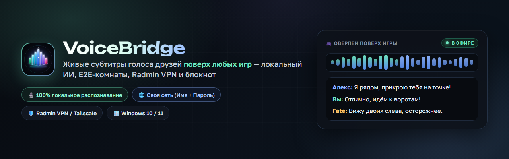
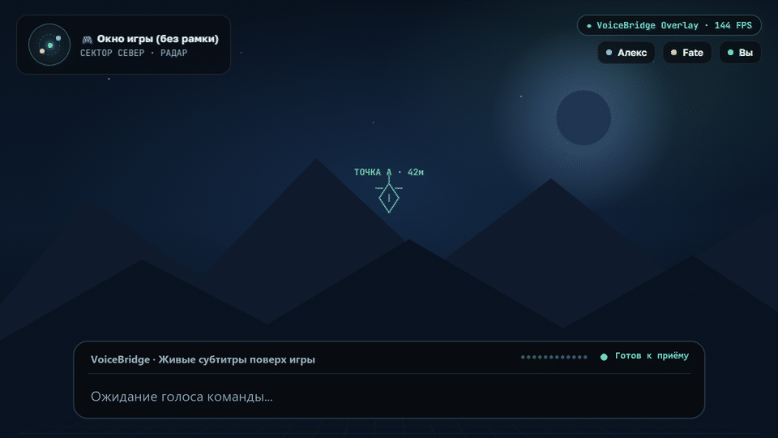
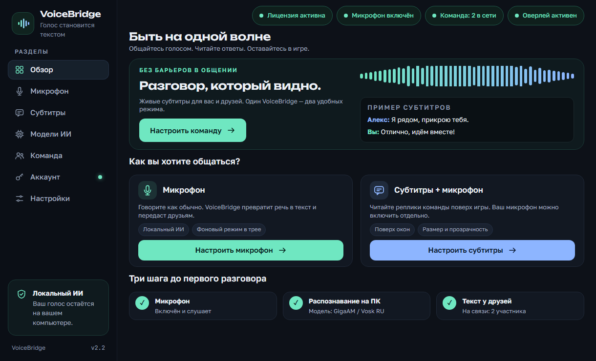
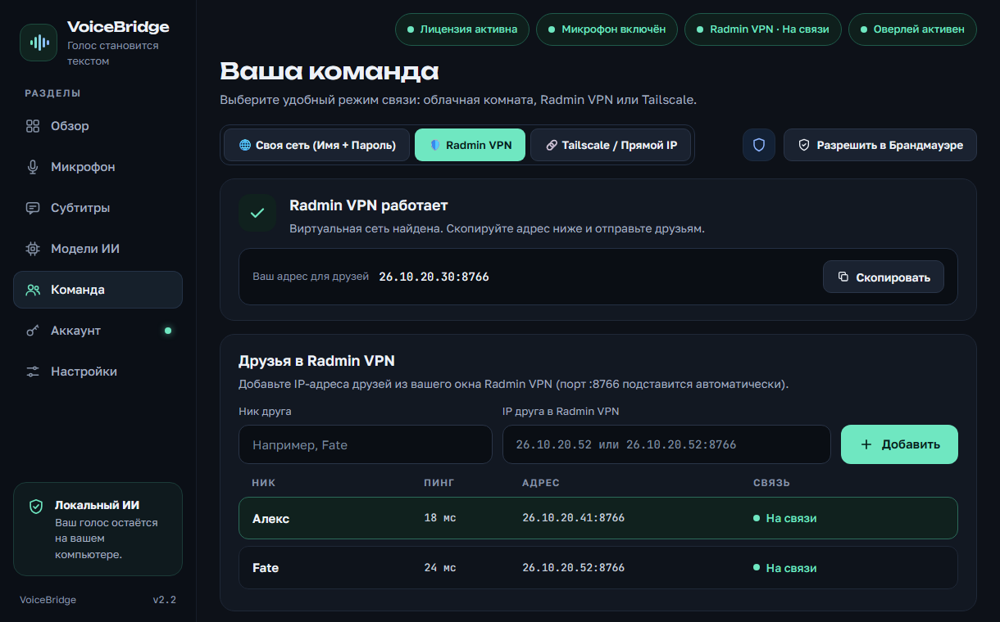
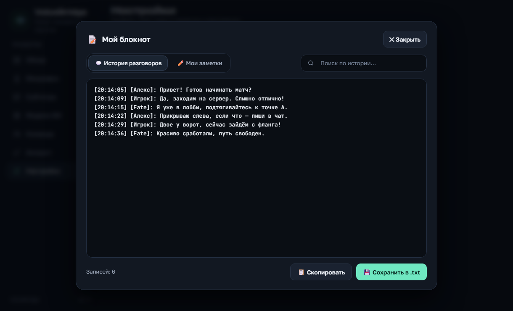

  

**Голос становится текстом прямо поверх любимых игр.**
Лёгкие настраиваемые субтитры речи команды — с локальным распознаванием на вашем ПК, выбором сети и встроенным блокнотом.

[📦 Скачать v2.2](https://github.com/sakleam1414/VoiceBridge/releases/download/v2.2/VoiceBridge.exe) · [🎬 Демо поверх игры](#demo) · [✨ Возможности](#features) · [🖼️ Скриншоты](#screenshots) · [❓ Частые вопросы](#faq)

---

> [!NOTE]
> **ⓘ Приватность и 100% локальная обработка голоса**
> Распознавание речи выполняется **прямо на вашем компьютере** (офлайн-модели ИИ) — аудиопоток с микрофона никуда не загружается и не сохраняется на сторонних серверах. Друзья получают только готовый текст реплик.

## 🎬 Демонстрация поверх игры

Ниже показана работа прозрачного оверлея **VoiceBridge** прямо во время игровой сессии: текст появляется по мере речи каждого игрока с цветовой подсветкой ников.

  

> [!IMPORTANT]
> Для корректного отображения субтитров поверх игры выберите в настройках самой игры режим **«Оконный без рамки»** *(Borderless Windowed)*. При активном переключателе **«Пропускать клики в игру»** оверлей становится полностью прозрачным для мыши и не мешает управлению.

---

## ✨ Основные возможности

| Статус | Функция | Описание |
| :---: | :--- | :--- |
| ✅ | **🎙️ Локальное распознавание речи** | Движки ИИ (**GigaAM**, **Vosk**, **Whisper**) работают прямо на вашем ПК с минимальной задержкой. |
| ✅ | **💬 Живой оверлей поверх игр** | Настройка шрифта, непрозрачности фона, количества строк, времени показа и режима пропуска кликов. |
| ✅ | **🌐 Своя сеть (Имя + Пароль)** | Быстрое создание закрытой облачной комнаты с E2E-шифрованием без VPN и настройки роутера. |
| ✅ | **🛡️ Встроенная вкладка Radmin VPN** | Автоопределение виртуального адреса, пинг участников и быстрая настройка брандмауэра в 1 клик. |
| ✅ | **🔗 Tailscale и прямой IP** | Поддержка виртуальной сети Tailscale и прямого подключения по локальному/сетевому адресу. |
| ✅ | **📝 Встроенный «Мой блокнот»** | Полная история разговоров с мгновенным поиском, личные заметки и экспорт в `.txt`. |
| ✅ | **🧹 Мод автоочистки истории** | Автоматическое удаление старых записей по расписанию (настраиваемый срок хранения в днях). |
| ✅ | **🎨 Темы и автообновление** | Несколько тёмных тем, пользовательские обои, сворачивание в трей и обновление в 1 клик. |

> [!TIP]
> **💡 Какой режим связи выбрать?**
> - Если хотите **самый быстрый старт** без установки дополнительных программ — используйте **🌐 Свою сеть (Имя + Пароль)**.
> - Если ваша команда уже собирается через **Radmin VPN** или **Tailscale** — выберите соответствующую вкладку в разделе «Команда», скопируйте адрес и нажмите при необходимости **🛡️ Разрешить в Брандмауэре**.

---

## 🖼️ Интерфейс программы

<table>
  <tr>
    <td align="center" width="50%">
      
       
      <b>🏠 Обзор и статус готовности</b> 
      Контроль микрофона, модели ИИ, статуса команды и оверлея в шапке
    </td>
    <td align="center" width="50%">
      
       
      <b>🛡️ Команда: Своя сеть, Radmin VPN и Tailscale</b> 
      Быстрое переключение режимов, список друзей с пингом и кнопка брандмауэра
    </td>
  </tr>
  <tr>
    <td align="center" colspan="2">
      
       
      <b>📝 Мой блокнот — История разговоров и личные заметки</b> 
      Удобный поиск по прошлым репликам, заметки для кодов комнат и экспорт в <code>.txt</code>
    </td>
  </tr>
</table>

---

## 🚀 Быстрый старт

1. 📥 **Скачайте** актуальный файл [`VoiceBridge.exe`](https://github.com/sakleam1414/VoiceBridge/releases/download/v2.2/VoiceBridge.exe) из раздела [Releases](https://github.com/sakleam1414/VoiceBridge/releases/latest).
2. 🎙️ Откройте вкладку **«Микрофон»**, выберите ваше устройство и загрузите удобную модель распознавания во вкладке **«Модели ИИ»**.
3. 🌐 Перейдите в раздел **«Команда»** и выберите подходящий способ связи: **Своя сеть**, **Radmin VPN** или **Tailscale / Прямой IP**.
4. 🎮 Включите оверлей на вкладке **«Субтитры»**, переведите игру в режим *«Оконный без рамки»* — готово!

> [!WARNING]
> **⚠️ Первый запуск на Windows**
> Поскольку программа распространяется как автономный `.exe` файл, фильтр Microsoft Defender SmartScreen может показать предупреждение при первом открытии. Нажмите **«Подробнее» → «Выполнить в любом случае»**.

---

## ❓ Частые вопросы

🌐 <b>Как играть с друзьями без установки VPN?</b>

 
Откройте раздел <b>Команда → 🌐 Своя сеть (Имя + Пароль)</b>. Придумайте короткое имя комнаты и пароль, нажмите <b>«Создать свою сеть»</b> и отправьте эти же данные друзьям. Участники подключатся напрямую через защищённый шифрованный канал.

🛡️ <b>У друга в Radmin VPN или Tailscale пишет «Нет ответа» — что делать?</b>

 
Убедитесь, что у обоих запущены VPN-клиент и VoiceBridge, а затем нажмите компактную кнопку <b>🛡️ Разрешить в Брандмауэре</b> в верхней панели раздела «Команда» (справа от вкладок), чтобы разрешить входящие подключения по рабочему порту.

🎙️ <b>Почему субтитры не видно поверх моей игры?</b>

 
В полноэкранном эксклюзивном режиме (Exclusive Fullscreen) Windows блокирует отображение сторонних окон поверх игры. Переключите видеорежим в настройках игры на <b>«Оконный без рамки» (Borderless)</b>.

🔑 <b>Где получить доступ и куда писать при вопросах?</b>

 
Оформление доступа и продление доступны в боте <a href="https://t.me/VoiceBridgePayBot">@VoiceBridgePayBot</a>, а по любым техническим вопросам обращайтесь в поддержку: <a href="https://t.me/voicebridge_help">@voicebridge_help</a>.

---

<b>VoiceBridge v2.2</b> · Windows 10 / 11 · Сделано для комфортного общения в играх

